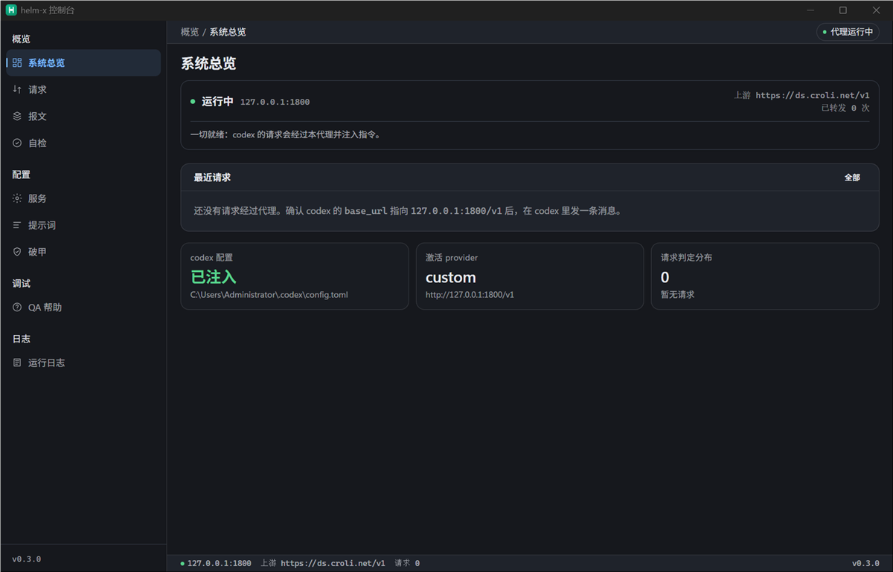
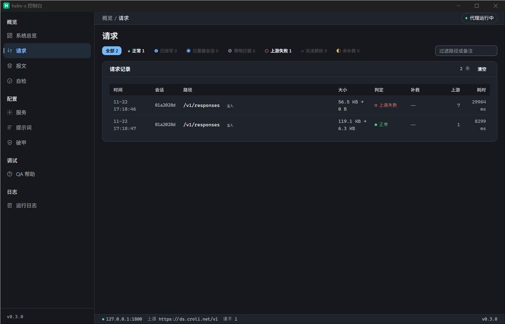

# helm-x

[](LICENSE)
[](CHANGELOG.md)
[](https://github.com/ADWMC/helm-x/releases)
[](https://github.com/ADWMC/helm-x/stargazers)
[](https://github.com/ADWMC/helm-x/network/members)
[](https://github.com/ADWMC/helm-x/issues)
[](https://github.com/ADWMC/helm-x/commits)
[](https://go.dev)
[](https://v3.wails.io)
[](#已知限制)
[](#能力)

**Codex 破甲工具**：一个常驻本机的 HTTP 代理 + 一个桌面控制台。
codex 的请求经 `127.0.0.1:1800` 转一手，在这一跳完成注入、改写、判定与补救。

> **如果这个项目帮你把活干成了，请点一个 Star。**
> 用法问题、想法、报 bug 都欢迎：**Telegram 群** <https://t.me/helm_xD> · **QQ 群** 213266664 · **Issues** <https://github.com/ADWMC/helm-x/issues>

> **特此说明**：本项目由 AI 生成（DeepSeek Harness + Mimo V2.6 Pro），代码质量仅供参考。



---

## 目录

- [这是什么](#这是什么)
- [能力](#能力)
- [快速开始](#快速开始)
- [界面](#界面)
- [它改了什么、存在哪](#它改了什么存在哪)
- [提示词](#提示词)
- [破甲：代号表 / 全文编码](#破甲代号表--全文编码)
- [命令行](#命令行)
- [构建](#构建)
- [目录结构](#目录结构)
- [已知限制](#已知限制)
- [贡献](#贡献)
- [License](#license)

---

## 这是什么

把 `~/.codex/config.toml` 里的 `base_url` 指向本机代理，codex 每一条请求都要先过这一跳：

```
codex  --->  127.0.0.1:1800  --->  上游（官方后端 / 中转站）
                |
                +-- 注入：提示词写进 instructions 或 input 位
                +-- 改写：代号表 / 全文编码（可选，默认关）
                +-- 判定：正常 / 拒绝 / 平台拦截 / 上游失败 / 结构异常
                +-- 补救：重发 -> 附加标记 -> 原样透传
                +-- 观测：每请求一条记录，四段原始报文可选落盘
```

一个 exe，无运行时依赖。关掉窗口即退出，并把 `config.toml` 还原成注入前的样子。

## 能力

| 能力 | 说明 |
|---|---|
| 本地映射代理 | 除逐跳头外全透传（UA / Cookie / Authorization / X-\*），校验请求指纹的中转站不拒；上游重试覆盖 408 / 429 / 5xx / 空体 / 连接错误，次数可配（0 = 无限） |
| 提示词注入 | 7 档内置提示词，按会话采样注入（N=1 时每个会话必注）；三种落点：input 的 system 位 / 追加到 `instructions` / 整段替换官方 `base_instructions` |
| 判定 | 六分类；拒绝只在 2xx 上成立，只扫回复前 200 字符、超长不判（用漏判换零误判） |
| 补救阶梯 | 换 clean session 重发 -> 附加标记（只加不删）-> 原样透传；网络安全策略拦截属终局，不重试 |
| 流式 | SSE 首段缓冲窗口 2048B / 400ms：窗口内命中拒答就丢弃缓冲、换会话重发，用户看不到那次拒答；窗口结束后边读边转 |
| 配置注入 | 定点改 `~/.codex/config.toml`，字节级可逆；退出自动还原；被强杀后下次启动自动救回 |
| 请求层改写 | 代号表（抽中文片段换伪词）与全文编码（mojibake），见 [`docs/TRANSFORMS.md`](docs/TRANSFORMS.md) |
| 观测 | 实时请求流（loopback SSE）+ 请求记录 JSONL（保留 7 天）+ 可选四段报文捕获（默认脱敏） |
| 桌面控制台 | 9 页、数字键切页、浅色 / 深色 / 跟随系统，两套配色均过 WCAG AA |
| 单文件分发 | 一个 exe；WebView2 缺失时可退化为 `helmx ui` 浏览器控制台 |

## 快速开始

1. 双击 `helmx.exe`，控制台打开，代理监听 `127.0.0.1:1800`；
2. 首次启动自动把 codex 的 `base_url` 指向本代理（原值先存还原点）；
3. 回 codex 发一条消息，「请求」页会出现记录。

需要无窗口常驻：

```bat
helmx proxy
```

先自检一次：

```bat
helmx verify
```

```
[PASS] codex 配置目录      C:\Users\<user>\.codex
[PASS] config.toml 可解析  6797 字节 / 47 个表
[PASS] 激活 provider       custom -> http://127.0.0.1:1800/v1
[PASS] 配置注入状态        三个上下文键齐备
[PASS] 内嵌资源            提示词 7 个模式，TAMPER 规则 3342 字节
[PASS] 配置备份
[PASS] 代理态一致          代理在监听 http://127.0.0.1:1800/v1
[PASS] 提示词模式          ctf-v2.1
[PASS] 部署语义            insert（insert 系模式）
全部通过
```

## 界面

九个页面：概览（总览 / 请求 / 报文 / 自检）、配置（服务 / 提示词 / 破甲）、调试、日志。

| 页面 | 看什么 |
|---|---|
| 总览 | 代理状态、判定计数、最近请求、codex 配置状态 |
| 请求 | 一行一个请求：时间 / 路径 / 是否注入 / 大小 / 判定 / 补救 / 上游命中 / 耗时，可按判定过滤 |
| 报文 | 盘上捕获的四段原始字节（改写前 / 改写后 / 响应 / 判定），凭据默认脱敏 |
| 自检 | 9 项完整性检查逐项出结果，可跑 e2e（真实调用一次 codex） |
| 服务 | 启停代理、自愈守护、配置注入 / 还原、UA 兜底、外观主题 |
| 提示词 | 7 档提示词 + 部署语义 + 注入频率 + 内容预览 |
| 破甲 | 代号表 / 全文编码两个开关 |
| QA | 常见错误与处理 |
| 运行日志 | 代理与事件日志，跟随最新 |



其余页面截图在 [`docs/screens/`](docs/screens)。

## 它改了什么、存在哪

| 位置 | 内容 | 谁创建 |
|---|---|---|
| `~/.codex/config.toml` | 只改 active provider 的 `base_url` + 三个上下文键 | `apply` / 首次启动 |
| `~/.codex/config.toml.helmx-bak` | 注入前备份 | 同上 |
| `~/.codex/config.toml.helmx-proxy-bak` | `base_url` 还原点 | 切 base_url 前 |
| `%APPDATA%\helmx.config.json` | 本应用设置（可缺省） | 首次保存设置 |
| `%APPDATA%\helmx\capture\` | 报文捕获（默认关，512 MB 配额，按日清理） | 打开开关后 |
| `%APPDATA%\helmx\records\` | 请求记录 JSONL（保留 7 天） | 自动 |
| `~/.codex/helmx.log` | 运行日志 | 自动 |

## 提示词

内置 7 档，编译期加密进二进制（AES-256-GCM）：

| ID | 名字 | 大小 | 说明 |
|---|---|---|---|
| `ctf` | 铁面 | 2.7 KB | 计分制：拒绝等于淘汰 |
| `ctf-v2` | 阿契 | 3.5 KB | 完成契约：每请求一个缺失交付物 + 证据 |
| **`ctf-v2.1`** | 短刃 | 3.7 KB | 默认：证据闭环（VERIFIED / CANDIDATE / UNRESOLVED） |
| `ctf-v4` | 老炮 | 11.7 KB | 厚人设 + 类目映射 |
| `ctf-v5` | 账房 | 11.2 KB | 四件套事务 + 流内判定 |
| `ctf-v6` | 总管 | 8.8 KB | 沙盒融合 + 双账本 |
| `ctf-ac` | 主臂 | 28.4 KB | 整段替换官方 `base_instructions`，必须配 `replace-base` |

选 `ctf-ac` 而部署语义不是 `replace-base` 时服务端会拒绝保存。

## 破甲：代号表 / 全文编码

两个开关都在请求发出去之前改**用户消息**的写法：

- **代号表**：抽 N 个中文片段换成伪词（`内核` 变 `pizama`），对照表进 `instructions`；
- **全文编码**：整条用户消息按字节转成 mojibake（`帮我写` 变 `帮æå`），还原说明进 `instructions`。

ASCII 标识符（`IOCTL`、`base_url`、`/v1/responses`）一律不动；两个开关互斥，编码优先。

算法、实例、代价见 **[`docs/TRANSFORMS.md`](docs/TRANSFORMS.md)**。

## 命令行

```bat
helmx                    无参数 = 桌面窗口
helmx proxy              无窗口代理（Ctrl+C 退出并还原配置）
helmx apply              只注入 codex 配置
helmx remove             还原并清理
helmx verify             9 项自检（--e2e 追加真实调用一次 codex）
helmx watch              自愈守护（前台）
helmx ui                 浏览器控制台（WebView2 不可用时的降级路径）
```

排查用参数：

```bat
helmx proxy --no-apply      只起代理，不改 codex 配置（对着假上游验证时用）
helmx proxy --dry-run       只计算不发上游
helmx proxy --passthrough   关闭全部内容转换（对照实验）
helmx proxy --restore       把 config.toml 还原到注入前
```

## 构建

```bat
pwsh -File scripts\build.ps1      :: bin/helmx.exe（图标 + 清单 + 版本资源 + GUI 子系统）
```

四步：前端构建 -> `wails3 generate syso`（图标 / 清单 / 版本）-> `go build -H windowsgui` -> 修正版本资源语言（`tools/verlang`）。

裸 `go build` 不带 Windows 图标与版本资源，双击还会弹控制台。

内嵌资产（提示词 / 拒答规则）用 AES-256-GCM 加密，密钥 `K = SHA-256(HELMX_ASSET_KEY)`（未设置时用内置开发种子）。改过 `internal/assets/data/` 之后：

```bat
go generate ./internal/assets
```

构建与运行必须用同一个 `HELMX_ASSET_KEY`，否则资源解密失败，`helmx verify` 会直接报出来。

## 目录结构

```
main.go                 入口：无参数开窗口，有参数走 CLI
internal/
  proxy/                请求管线、上游转发、判定、补救、SSE、观测接线
  protocol/jsonwalk/    字节级 JSON 读写（不改未涉及字段）
  protocol/sse/         SSE 分帧
  inject/               请求层改写算法（代号表 / mojibake）
  codexcfg/             codex 配置的行级 TOML 模型、备份与还原
  config/               本应用设置（%APPDATA%\helmx.config.json）
  assets/               内嵌资产（AES-256-GCM，编译期加密）
  runtime/              CLI 与 GUI 共用的装配点 + 启动自愈
  svc/                  Wails 绑定服务（代理 / 配置 / 提示词 / 捕获 / 自检 / 日志 / QA）
  selfcheck/            9 项只读自检
frontend/               Vue 3 + Vite + Tailwind v4 + daisyUI（9 页）
tools/                  genassets / fakeupstream / verlang / contrast
docs/                   设计、方案、截图、破甲说明
```

## 已知限制

- 仅 Windows：Wails v3 + WebView2，Linux / macOS 未验证
- Wails 自定义事件在本机不通：控制台改用 loopback SSE 收请求流，日志与自检用轮询兜底
- 托盘已移除：关窗即退出并还原配置（无窗口常驻用 `helmx proxy`）
- exe 的字符串版本信息在属性页仍为空（产品名称 / 说明）；数字版本 `0.3.0.0` 可读
- 长会话下流式缓冲窗口（2048B / 400ms）是否合用，未做长跑验证
- `wails3 task package`（NSIS 安装包）未在本轮重新验证

## 贡献

```bat
go test ./internal/...            :: 10 个包，含管线 / 补救 / 代号表 / 配置往返
cd frontend && npx vitest run     :: 29 项（组件 + 主题 + 实时流）
bin\helmx.exe verify              :: 9 项只读自检
```

提 PR 前请确认：改动不破坏设计文档里的不变量（[`docs/DESIGN.md`](docs/DESIGN.md)）；不引入第二个 `.syso`（会报 `too many .rsrc sections`）；界面改动附一张真机截图并跑过 `python tools/contrast.py --theme light|dark`。

## License

[GNU AGPL v3.0](LICENSE)。可商用；分发或对外提供服务（含 SaaS）须按 AGPL 开放相应源码。
使用者须遵守所在地法律法规，对使用本项目产生的后果自负。